# Entity Relationship Diagram (ERD) - RichiStock (Versi Lengkap & Terintegrasi)

Dokumen ini memuat skema relasi entitas lengkap untuk sistem manajemen inventaris **RichiStock** (Central Kitchen & 3 Outlet Cabang: Alauddin, PK3, BTP), mencakup modul Operasional, Transfer Antar Cabang, Kadaluarsa (FEFO), Tutup Shift, Opname, dan Audit Trail.

---

## 1. Diagram ERD (Mermaid Notation)

```mermaid
erDiagram
    OUTLETS {
        int id PK
        varchar nama
        enum tipe "PUSAT|CABANG"
        text alamat
        boolean is_active
        timestamp created_at
        timestamp updated_at
    }

    USERS {
        int id PK
        varchar nama
        varchar username UK
        varchar password_hash
        enum role "OWNER|ADMIN_PUSAT|STAF_CABANG"
        int outlet_id FK
        boolean is_active
        timestamp created_at
        timestamp updated_at
    }

    PRODUCTS {
        int id PK
        varchar kode UK
        varchar nama
        varchar satuan
        varchar kategori
        numeric harga
        int urutan
        boolean satuan_perlu_konfirmasi
        varchar satuan_besar
        int konversi
        int shelf_life_days
        boolean is_active
        timestamp created_at
        timestamp updated_at
    }

    PAR_STOCKS {
        int id PK
        int product_id FK
        int outlet_id FK
        int min_qty
        timestamp created_at
        timestamp updated_at
    }

    STOCKS {
        int id PK
        int product_id FK
        int outlet_id FK
        int qty_current
        timestamp created_at
        timestamp updated_at
    }

    OPENING_BALANCES {
        int id PK
        int product_id FK
        int outlet_id FK
        int qty
        date tanggal
        int created_by FK
        timestamp created_at
        timestamp updated_at
    }

    STOCK_MUTATIONS {
        int id PK
        int product_id FK
        int outlet_id FK
        date tanggal
        enum shift "MIDNIGHT|PAGI|SORE"
        int saw
        int masuk
        int keluar
        int sak
        numeric harga_snapshot
        boolean is_opening
        int created_by FK
        enum sumber_masuk "MANUAL|TIKET"
        int ticket_id FK
        timestamp created_at
        timestamp updated_at
    }

    RESTOCK_TICKETS {
        int id PK
        varchar kode_tiket UK
        int outlet_id FK
        int requested_by FK
        enum status "DIAJUKAN|DIPROSES|SELESAI"
        text catatan
        int processed_by FK
        timestamp processed_at
        int received_by FK
        timestamp received_at
        boolean ada_selisih
        timestamp created_at
        timestamp updated_at
    }

    RESTOCK_TICKET_ITEMS {
        int id PK
        int ticket_id FK
        int product_id FK
        int qty_diminta
        int qty_dikirim
        int qty_diterima
    }

    BRANCH_TRANSFERS {
        int id PK
        varchar kode_transfer UK
        int from_outlet_id FK
        int to_outlet_id FK
        int product_id FK
        int qty
        text catatan
        int created_by FK
        timestamp created_at
    }

    PRODUCT_BATCHES {
        int id PK
        int product_id FK
        int outlet_id FK
        varchar batch_no
        int qty
        date tanggal_masuk
        date expired_date
        text catatan
        int created_by FK
        timestamp created_at
        timestamp updated_at
    }

    DEFECT_REPORTS {
        int id PK
        int outlet_id FK
        int product_id FK
        int qty
        text deskripsi
        varchar foto_url
        enum status "BARU|DITINJAU|SELESAI|DISETUJUI|DITOLAK|PENDING"
        int reported_by FK
        timestamp created_at
        timestamp updated_at
    }

    SHIFT_CLOSINGS {
        int id PK
        int outlet_id FK
        varchar shift_name
        date shift_date
        varchar status
        int total_items_in
        int total_items_out
        int total_defect_cases
        text notes
        int closed_by_id FK
        varchar closed_by_name
        int unlocked_by_id FK
        timestamptz unlocked_at
        timestamptz created_at
        timestamptz updated_at
    }

    STOCK_OPNAMES {
        int id PK
        varchar kode UK
        int outlet_id FK
        date tanggal
        enum status "DRAFT|FINAL|APPROVED"
        text catatan
        int created_by FK
        int finalized_by FK
        timestamp finalized_at
        timestamp created_at
        timestamp updated_at
    }

    STOCK_OPNAME_ITEMS {
        int id PK
        int opname_id FK
        int product_id FK
        int qty_sistem
        int qty_fisik
        int selisih
        numeric harga_snapshot
        text alasan
        timestamp created_at
        timestamp updated_at
    }

    ASSETS {
        int id PK
        varchar kode UK
        varchar nama
        varchar kategori
        int urutan
        boolean is_active
        timestamp created_at
        timestamp updated_at
    }

    ASSET_STOCKS {
        int id PK
        int asset_id FK
        int outlet_id FK
        int qty_baik
        int qty_rusak
        text keterangan
        timestamp created_at
        timestamp updated_at
    }

    ASSET_OPNAME_ITEMS {
        int id PK
        int opname_id FK
        int asset_id FK
        int qty_sistem
        int qty_fisik
        int selisih
        text alasan
        timestamp created_at
        timestamp updated_at
    }

    NOTIFICATIONS {
        int id PK
        int outlet_id FK
        int product_id FK
        text pesan
        enum tipe "PAR_STOCK|TIKET|DEFECT"
        boolean is_read
        timestamp created_at
    }

    AUDIT_LOGS {
        int id PK
        int user_id FK
        varchar user_name
        varchar role
        int outlet_id FK
        varchar outlet_name
        varchar module
        varchar action
        text description
        jsonb details
        varchar ip_address
        timestamptz created_at
    }

    %% =======================
    %% RELASI OUTLETS (CABANG)
    %% =======================
    OUTLETS ||--o{ USERS : "memiliki pegawai"
    OUTLETS ||--o{ STOCKS : "menyimpan stok aktif"
    OUTLETS ||--o{ PAR_STOCKS : "memiliki limit minimum"
    OUTLETS ||--o{ OPENING_BALANCES : "memiliki saldo awal"
    OUTLETS ||--o{ STOCK_MUTATIONS : "mencatat mutasi harian"
    OUTLETS ||--o{ RESTOCK_TICKETS : "mengajukan tiket order"
    OUTLETS ||--o{ BRANCH_TRANSFERS : "sebagai cabang asal (from)"
    OUTLETS ||--o{ BRANCH_TRANSFERS : "sebagai cabang tujuan (to)"
    OUTLETS ||--o{ PRODUCT_BATCHES : "menyimpan batch kadaluarsa"
    OUTLETS ||--o{ DEFECT_REPORTS : "mencatat barang cacat"
    OUTLETS ||--o{ SHIFT_CLOSINGS : "menjalankan tutup shift"
    OUTLETS ||--o{ STOCK_OPNAMES : "melaksanakan audit opname"
    OUTLETS ||--o{ ASSET_STOCKS : "memiliki aset peralatan"
    OUTLETS ||--o{ NOTIFICATIONS : "menerima peringatan"
    OUTLETS ||--o{ AUDIT_LOGS : "lokasi aktivitas audit"

    %% =======================
    %% RELASI PRODUCTS (BARANG)
    %% =======================
    PRODUCTS ||--o{ STOCKS : "saldo stok di outlet"
    PRODUCTS ||--o{ PAR_STOCKS : "batas minimum di outlet"
    PRODUCTS ||--o{ OPENING_BALANCES : "saldo awal di outlet"
    PRODUCTS ||--o{ STOCK_MUTATIONS : "dicatat pada mutasi"
    PRODUCTS ||--o{ RESTOCK_TICKET_ITEMS : "dipesan dalam tiket"
    PRODUCTS ||--o{ BRANCH_TRANSFERS : "ditransfer antar cabang"
    PRODUCTS ||--o{ PRODUCT_BATCHES : "dilacak nomor batch-nya"
    PRODUCTS ||--o{ DEFECT_REPORTS : "dilaporkan rusak/defect"
    PRODUCTS ||--o{ STOCK_OPNAME_ITEMS : "dihitung pada opname"
    PRODUCTS ||--o{ NOTIFICATIONS : "subjek notifikasi stok"

    %% =======================
    %% RELASI USERS (PENGGUNA)
    %% =======================
    USERS ||--o{ STOCK_MUTATIONS : "menginput mutasi"
    USERS ||--o{ RESTOCK_TICKETS : "membuat order (requested_by)"
    USERS ||--o{ RESTOCK_TICKETS : "memproses kiriman (processed_by)"
    USERS ||--o{ RESTOCK_TICKETS : "menerima kiriman (received_by)"
    USERS ||--o{ BRANCH_TRANSFERS : "membuat transfer cabang"
    USERS ||--o{ PRODUCT_BATCHES : "mendaftarkan batch masuk"
    USERS ||--o{ DEFECT_REPORTS : "melaporkan defect"
    USERS ||--o{ SHIFT_CLOSINGS : "menutup shift (closed_by)"
    USERS ||--o{ STOCK_OPNAMES : "membuat draft opname"
    USERS ||--o{ STOCK_OPNAMES : "memfinalisasi opname"
    USERS ||--o{ OPENING_BALANCES : "menginput saldo awal"
    USERS ||--o{ AUDIT_LOGS : "pelaku aktivitas sistem"

    %% =======================
    %% RELASI ASSETS (ALAT)
    %% =======================
    ASSETS ||--o{ ASSET_STOCKS : "unit aset di tiap cabang"
    ASSETS ||--o{ ASSET_OPNAME_ITEMS : "item fisik yang di-opname"

    %% =======================
    %% RELASI TRANSAKSI HEADER & DETAIL
    %% =======================
    RESTOCK_TICKETS ||--|{ RESTOCK_TICKET_ITEMS : "memiliki rincian item"
    RESTOCK_TICKETS ||--o{ STOCK_MUTATIONS : "dikonversi menjadi mutasi masuk"

    STOCK_OPNAMES ||--o{ STOCK_OPNAME_ITEMS : "rincian bahan opname"
    STOCK_OPNAMES ||--o{ ASSET_OPNAME_ITEMS : "rincian aset opname"
```

